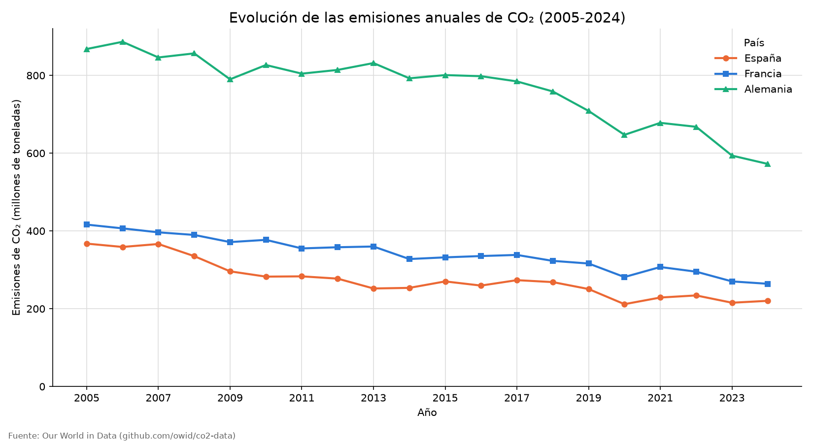
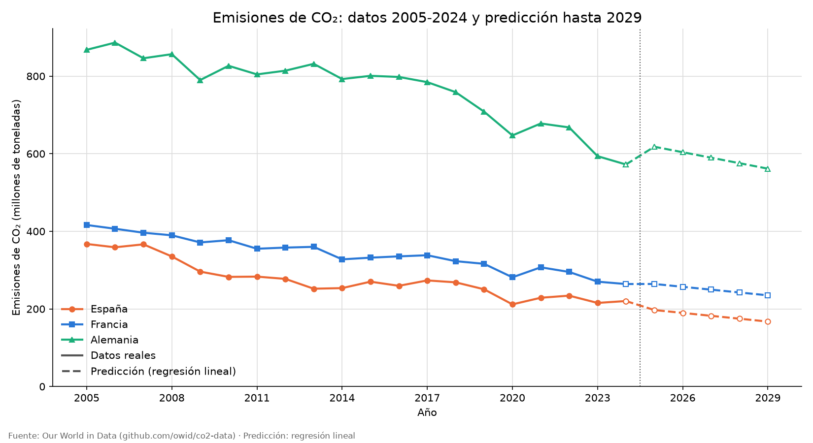
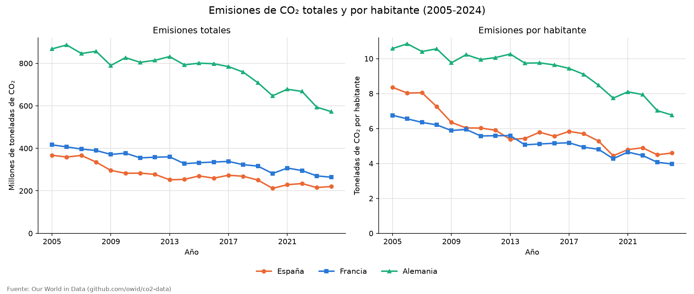

# Análisis de emisiones de CO₂ — España, Francia y Alemania


[](LICENSE)

Solución del reto práctico de **analista de datos medioambientales**: análisis de
la evolución de las emisiones de CO₂ de España, Francia y Alemania con datos
históricos de [Our World in Data](https://github.com/owid/co2-data).

El programa explora y procesa los datos, calcula medias y variaciones, genera
gráficos, hace una predicción a 5 años con regresión lineal y exporta los
resultados a CSV. Todo con un menú interactivo, tests automatizados y estilo de
código revisado con [ruff](https://docs.astral.sh/ruff/).



## Qué hace

**Análisis**

1. **Exploración de los datos**: número de registros y columnas, campos de país,
   año y emisiones (con su unidad, tomada del codebook de OWID), columnas con
   cantidades de emisiones y valores nulos.
2. **Procesamiento**:
   - Filtra los países elegidos (columna `co2`, en millones de toneladas).
   - Descarta registros sin un valor de emisiones válido (nulo, no numérico o
     negativo) e informa de cuántos son y de qué años.
   - Analiza solo los años en los que **todos** los países tienen dato, para que
     sean comparables, y de ellos los últimos 20.
   - Calcula la media anual de cada país y la variación porcentual entre el
     primer y el último año, señalando el país con mayor reducción.
3. **Visualización**: `resultados/evolucion_co2.png`, gráfico de líneas con
   título, leyenda y ejes etiquetados.

**Ampliaciones**

- **Menú interactivo** para elegir países y período, con validación de entradas.
- **Predicción a 5 años** (`resultados/prediccion_co2.png`): regresión lineal
  por mínimos cuadrados (`numpy.polyfit`) por país, con su tendencia (Mt/año) y
  el R² del ajuste.
- **Totales vs. por habitante** (`resultados/total_vs_per_capita.png`): tabla,
  gráfico de dos paneles y una interpretación generada a partir de los datos.
- **Exportación a CSV** (separador `;` y coma decimal, para abrir en Excel):
  - `emisiones_filtradas.csv`: datos anuales usados (CO₂, CO₂ por habitante, población).
  - `resumen_por_pais.csv`: media, variación, datos por habitante y tendencia.
  - `prediccion_co2.csv`: emisiones previstas para los 5 años siguientes.

## Resultados de ejemplo (2005-2024)

| País     | CO₂ medio (Mt) | CO₂ 2005 (Mt) | CO₂ 2024 (Mt) | Variación | CO₂/hab (t) | Tendencia (Mt/año) |   R² |
|----------|---------------:|--------------:|--------------:|----------:|------------:|-------------------:|-----:|
| España   |          275,3 |         367,4 |         220,3 |   -40,0 % |        5,91 |              -7,44 | 0,83 |
| Francia  |          341,1 |         416,3 |         264,2 |   -36,6 % |        5,31 |              -7,31 | 0,95 |
| Alemania |          766,3 |         867,9 |         572,3 |   -34,1 % |        9,32 |             -14,12 | 0,84 |

En el período analizado, España es el país que más ha reducido sus emisiones
(-40,0 %). Alemania emite de media 2,8 veces más CO₂ que España en términos
totales, pero solo 1,6 veces más por habitante; y por habitante, España supera a
Francia aunque en total emita menos.





> **Nota sobre la predicción**: es un modelo sencillo que supone que la
> tendencia del período se mantiene. La recta resume todos los años del período,
> no parte del último dato real, así que el primer año previsto puede quedar por
> encima o por debajo de este. Un R² bajo indica que la recta explica mal los
> datos.

## Estructura del proyecto

```
reto-medioambiental/
├── main.py                # punto de entrada (menú interactivo o --todo)
├── co2/
│   ├── config.py          # rutas, parámetros, países y configuración
│   ├── datos.py           # descarga de los CSV y apoyo a la exploración
│   ├── analisis.py        # cálculos (sin print ni gráficos)
│   ├── informes.py        # salida por pantalla
│   ├── graficos.py        # gráficos con matplotlib
│   ├── exportar.py        # exportación a CSV
│   ├── acciones.py        # une cálculos, informes y gráficos
│   └── menu.py            # menú interactivo
├── tests/
│   └── test_analisis.py   # 17 tests de los cálculos (pytest, sin internet)
├── datos/                 # CSV descargados de OWID (no se versionan)
├── resultados/            # salidas generadas: gráficos PNG y CSV
├── .vscode/
│   └── settings.json      # intérprete de Python para VS Code
├── requirements.txt       # dependencias del programa
├── requirements-dev.txt   # dependencias de desarrollo (tests y estilo)
├── pyproject.toml         # configuración de ruff y pytest
├── .gitignore
└── LICENSE                # licencia MIT
```

## Puesta en marcha

Requiere **Python 3.12 o superior** (probado con Python 3.14).

```bash
python3 -m venv .venv
source .venv/bin/activate        # Windows: .venv\Scripts\activate
pip install -r requirements.txt
```

En VS Code: `Cmd+Shift+P` → **Python: Select Interpreter** → elegir `.venv`.

## Uso

```bash
python main.py          # menú interactivo
python main.py --todo   # análisis completo sin menú (configuración por defecto)
python main.py --help   # ayuda
```

La primera ejecución descarga `owid-co2-data.csv` y `owid-co2-codebook.csv` en
`datos/`; las siguientes usa la copia local (borra `datos/` para volver a
descargarlos). Con `--todo` los gráficos se guardan pero no se abren. Para salir
del menú: `Ctrl+C` o la opción `0`.

### Menú

Todo se elige escribiendo un número y pulsando Enter:

```
VER RESULTADOS
 1. Medias, país con mayor reducción y gráfico de evolución
 2. Predicción de emisiones para los próximos 5 años
 3. Comparar emisiones totales y por habitante
 4. Todo lo anterior y además exportar a CSV

CAMBIAR LO QUE SE ANALIZA
 5. Cambiar países
 6. Cambiar años

OTROS
 7. Exportar resultados a CSV
 8. Ver cómo es el dataset (exploración de los datos)
 0. Salir
```

Por defecto se analizan España, Francia y Alemania en los últimos 20 años
disponibles. Cuando se abre un gráfico, hay que cerrar su ventana para continuar.

### Ejemplo de salida

```
Emisiones medias anuales de CO2 en el período (millones de t):
  - Alemania          766.33 Mt
  - Francia           341.14 Mt
  - España            275.32 Mt

Variación entre 2005 y 2024:
          CO2 2005 (Mt)  CO2 2024 (Mt)  Variación (%)
España           367.45         220.34         -40.03
Francia          416.34         264.16         -36.55
Alemania         867.88         572.32         -34.06

>> Mayor reducción porcentual: España (40.03 %)
```

## Tests y estilo de código

```bash
pip install -r requirements-dev.txt
python -m pytest        # 17 tests de los cálculos, con datos inventados
ruff check .            # revisión de estilo y errores
ruff format .           # formato automático
```

Los tests no necesitan internet: usan datos pequeños inventados.

## Los datos

[Our World in Data](https://github.com/owid/co2-data) publica emisiones anuales
de CO₂ y otros gases por país desde 1750 (consulta ese repositorio para ver las
fuentes detalladas del dataset). Los dos CSV que usa el programa se descargan de
OWID la primera vez y no se versionan: `datos/` está en el `.gitignore`.

## Licencia

Distribuido bajo la licencia [MIT](LICENSE). © 2026 Manuel Landeira.
